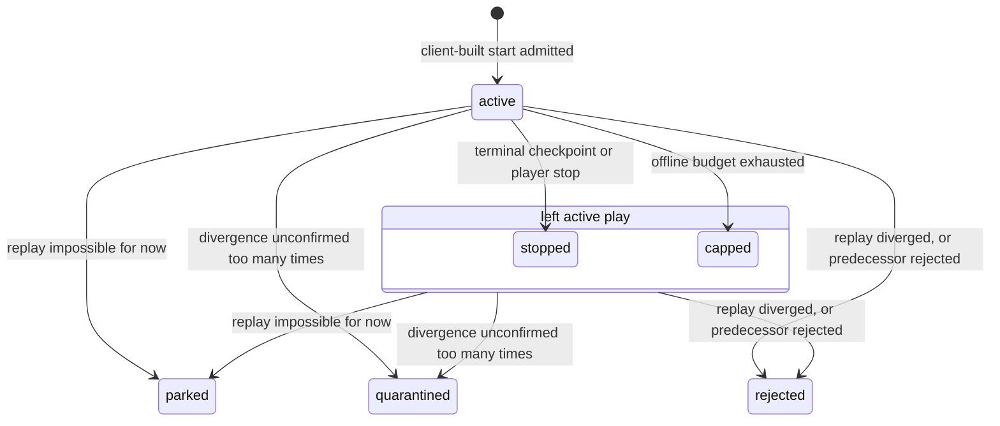

# Game lifecycle

In vers the client creates and simulates every activity. The server admits what the client submits,
proves it later by replay, settles one avatar's activities in the order they were played, and pays
only for what it has proved. If you read the code with a server-authoritative model in mind, it
seems to contradict the five game architecture docs in [Reading order](#reading-order). The docs
describe the model correctly.

Keep [`glossary.md`](../../../docs/architecture/game/glossary.md) open beside this skill. It defines
each game term used here, such as admit, settle, head row, appended anchor and verified anchor. This
skill hands nothing back. It tells you what to drop and where to read.

## Key rules

- [What's true in this system](#whats-true-in-this-system): drop the server-authoritative
  assumptions, and find the file that owns each concept.
- [Reading order](#reading-order): read the five game architecture docs in full before you open a
  file.
- [Activity statuses](#activity-statuses): one writer worker owns every transition on the client,
  and the server tracks proof on cursors, independent of the activity's status.

## What's true in this system

- **The client creates every activity start.** The writer worker, the one worker per browser profile
  that runs the simulation, builds the start from the inputs it cached at node reveal, and starts to
  simulate with no round trip.
  [`advanceActivity`](../../../services/activity/src/handlers/advance-activity.ts) admits the start:
  it derives every input again and refuses a mismatch.
- **The server inserts rows, and never builds an activity start.**
  [`mintActivityRoot`](../../../services/activity/src/handlers/mint-activity-root.ts) inserts the
  row for an admitted start. `advanceActivity` creates continuation rows on the offline catch-up
  path, and node reveal creates chain rows. `mint` in a server handler names one of these inserts.
- **The request path never simulates.** A queue-fed verifier in the replay service runs each
  submitted checkpoint again later.
  [`runReplayTarget`](../../../services/replay/src/worker/run-replay-target.ts) replays each one and
  judges it.
- **The checkpoint hash only links a checkpoint to the one before it.** Only a replay under the sim
  version that the activity start pins can validate a reward.
- **The server tracks proof on cursors.** `verified_head` on the head row and the verified anchor on
  the chain row record how far the server has proved. No status value stands for "verified", so a
  `stopped` activity can be fully proved, partly proved or not yet claimed.
- **A terminal checkpoint and a player stop both move the activity to `stopped`.** A `completed` and
  a `failed` checkpoint end the run the same way. Read the type of the last checkpoint to learn how
  the run ended.
  [`trackActivityProgress`](../../../services/activity/src/handlers/track-activity-progress.ts) owns
  the checkpoint append, the offline budget, and the moves to `stopped` and `capped`.
- **One avatar's activities settle in play order.** The client declares the order through
  `predecessorActivityId`. The verifier claims an activity only after every earlier one has settled
  or been rejected, in
  [`claimNextSeedChain`](../../../services/replay/src/queue/claim-next-seed-chain.ts). A `parked` or
  `quarantined` predecessor blocks the activities after it, and a `rejected` one fails them.
- **The server pays only for what it has proved.** The client shows optimistic state.
  [`applyVerifiedSegment`](../../../services/replay/src/apply/apply-verified-segment.ts) pays for
  each segment the verifier has matched, as it moves the head row's `verified_head`, so a run can
  pay before it ends. [`rejectActivity`](../../../services/replay/src/worker/reject-activity.ts)
  moves the appended anchor back, and never reverses a payout already made.
- **A node never re-rolls.** The seed chain is one forward sequence per avatar and node, so a failed
  attempt spends its positions and the next attempt continues past them.
- **`parked` and `quarantined` hold an avatar's settlement.** An operator releases a `quarantined`
  activity. A `parked` one returns to its earlier status when an operator acts, or when the
  scheduled replay sweep finds its sim version active again. The verifier rejects as cheating only a
  divergence it can reproduce under the sim version the activity start pins.
- **A backed-off activity keeps its status.** When a service the verifier calls fails, such as the
  database, [`updateReplayBackoff`](../../../services/replay/src/queue/update-replay-backoff.ts)
  sets a retry time, and the verifier skips the activity until then.

## Reading order

Read all five docs in full before you open a file, even for a fix to one function. The code puts one
export in each file, so no single file shows a flow.

1. [`glossary.md`](../../../docs/architecture/game/glossary.md): the terms the other four docs use
   without defining them.
2. [`game-simulation.md`](../../../docs/architecture/game/game-simulation.md): the deterministic
   core, the inputs a start pins, and checkpoint streams.
3. [`replay-verification.md`](../../../docs/architecture/game/replay-verification.md): the verifier,
   what settlement applies, and the sim-version registry.
4. [`seed-chain.md`](../../../docs/architecture/game/seed-chain.md): positions, the two anchors,
   what moves each, and the order the verifier claims work in.
5. [`offline-reconcile.md`](../../../docs/architecture/game/offline-reconcile.md): the connectivity
   states, fast-forward, settlement in order, held activities, and the worker lifecycle.

## Activity statuses

On the client, the writer worker owns every activity transition.
[`workerLifecycleMachine`](../../../libs/game/idle-client/src/worker/worker-lifecycle-machine.ts)
defines the writer worker's own states, such as idle, running and resyncing. The writer worker runs
one flow at a time. [`runResyncFlow`](../../../libs/game/idle-client/src/worker/run-resync-flow.ts)
decides what a reconnect or a reopen catches up, and
[`createCheckpointSubmitter`](../../../libs/game/idle-client/src/submission/create-checkpoint-submitter.ts)
owns the durable outbox and its flush.

On the server, each activity has one status on its head row. The server's proof moves on the cursors
whatever the status. This diagram joins transitions that several handlers own:

