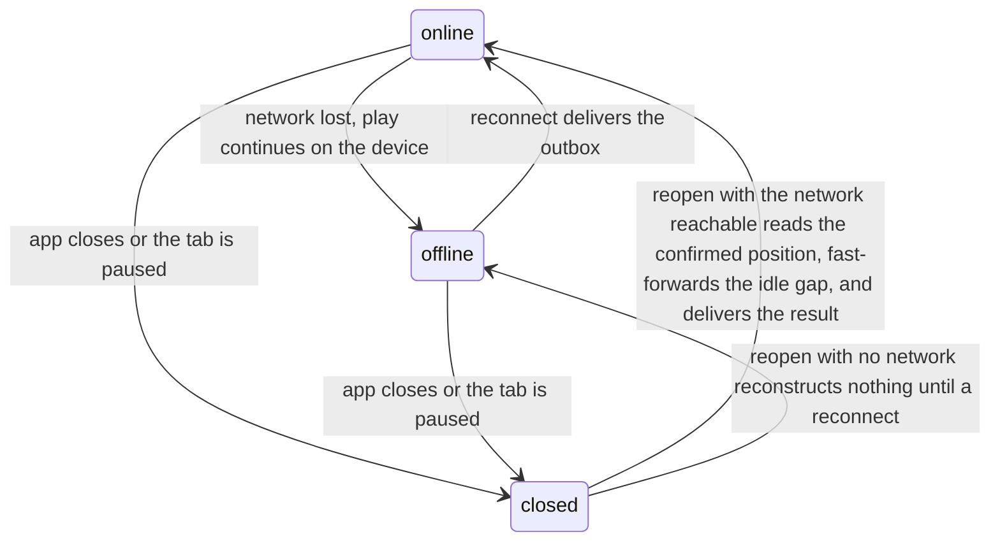

# Offline reconcile

On reconnect the device delivers the progress it made without the server, and the server checks and
settles it in play order. Progress an avatar makes while the server is out of contact lives only on
the device, because the client runs every simulation locally
([game simulation](./game-simulation.md)). The device delivers real work when the simulation kept
running while the server was out of contact, and a reconstructed idle gap when it did not.
[Replay verification](./replay-verification.md) owns the checks and the settlement, and the
[seed chain](./seed-chain.md) owns the positions each delivered activity claims. The game terms this
doc uses, such as node, checkpoint, appended anchor and build snapshot, carry the meaning the
[glossary](./glossary.md) gives them.

On the device, one writer worker per browser profile runs the simulation and owns the outbox: the
durable store of pending activity starts and queued checkpoints that offline play leaves behind. The
app's tabs show the worker's state and send it the player's intent
([worker lifecycle](#worker-lifecycle)).

## Three connectivity states

Whether the simulation runs, and whether the network is reachable, describe an avatar's situation.
Three states cover every case, because the network does not matter while the simulation is stopped.

| State       | App    | Simulation  | Network      |
| ----------- | ------ | ----------- | ------------ |
| **online**  | open   | running     | reachable    |
| **offline** | open   | running     | unreachable  |
| **closed**  | closed | not running | not relevant |

A backgrounded tab counts as closed even though the app is open. The browser can pause the writer
worker while the app is open and the network is reachable, so the simulation stops and a gap opens.

The network returning is a reconnect, and the app opening is a reopen. A reconnect starts the
reconcile. A reopen with the network reachable reconciles too, as the diagram shows. A device that
reopens while the network is unreachable enters the offline state directly, reconstructs no gap, and
delivers nothing until it later reconnects.

## Resuming: fast-forward first, then play

When the device resumes, it fast-forwards the gap between its last simulated position and now, then
resumes live play. A fast-forward re-simulates the elapsed time from that position,
deterministically, as re-attempts of the node the avatar was last on. A zero-length gap does
nothing. The simulation is local, but the worker reads the server's confirmed position before it
fast-forwards anything, so a fast-forward runs only once the server is reachable.

The fast-forward runs before live play resumes, because the server refuses a resumed activity that
skipped it:

- A stale chain position. The idle attempts spend chain positions, so the server's anchor check
  refuses an activity that resumes from the device's stale position
  ([seed chain](./seed-chain.md#handing-an-activity-start-to-the-server)).
- A stale build snapshot. The resumed activity carries a build snapshot without the XP the idle
  attempts earned, so the server rejects it as a mismatch on delivery.

Network availability gates the start of a fast-forward and the delivery of its result, never the
simulation between. The server enforces the anti-cheat limit at delivery: it meters the
[offline budget](./game-simulation.md#the-offline-budget) on each checkpoint append, and it settles
a fast-forward only up to where the budget runs out.

## Offline progress on another device

Resuming at full fidelity needs the device's own outbox: the pending activity starts and queued
checkpoints that offline play left behind. A same-device reopen has the outbox, and so does a new
writer worker in the same browser profile, so the worker delivers the activities played offline one
by one and fast-forwards any idle gap on top of them. A different device or browser profile reads a
different store. It knows only the last position the server confirmed, so it fast-forwards idle
attempts at that node instead, and the server never receives the nodes the player walked offline on
the original device. While the original device is offline or closed, nothing can reach its outbox,
so this loss follows from where the outbox lives.

An account holds one verified session, so verifying a session on a new device evicts every other
session the account owns ([auth](../services/auth.md#session-lifecycle)). The evicted device's next
server call fails, so the work that session never delivered never reaches the server, and the device
stops simulating the activity it held.

## Keeping the outbox intact

The worker commits each activity start together with the avatar's record of its last-started
activity, and each checkpoint together with the cached anchor of its node, so a browser that closes
mid-write keeps both or neither. The worker asks the browser to persist its storage when an activity
starts. That stops the browser from evicting the outbox under storage pressure, but it never stops
the player from clearing site data, so the outbox is safe only once the server has received it.

When the browser fails to write a checkpoint to the outbox, or the worker cannot read the outbox
back, the outbox holds no dependable record of the activity. On either failure the worker stops the
activity at the last checkpoint the outbox kept and reports the failure to the tabs.

## When a session ends

The outbox outlives the session that filled it, and the device keeps or discards it according to how
that session ended.

| What happened to the session | Its server session row | The device's outbox                                     |
| ---------------------------- | ---------------------- | ------------------------------------------------------- |
| Another device took it over  | deleted at once        | discarded                                               |
| The player signed out here   | deleted at once        | discarded, once the player confirms                     |
| It ran past its expiry       | left in place          | kept, and delivered once the same account signs back in |

A takeover discards the outbox without asking, because delivering it later would write progress the
player made elsewhere, and the device taking the account over warns the player first. The displaced
device halts its live activity before the discard, so the activity queues no checkpoint behind it.
Its tabs then show the activity as halted and playing on another device. On a sign-out, the player
decides through the sign-out control ([signing out](#signing-out)).

A discard drops the cached node seeds of the avatars it covers: each node's cached genesis seed and
appended anchor. Local play moved their appended anchors past what the server holds, and a node
reveal never moves a cached anchor backward on the same chain, so the cache would keep the device's
positions. The next node reveal caches the server's anchors.

### Signing out

Before it ends the session, the sign-out control asks the worker what the outbox holds. With an
empty outbox, the control signs the player out at once. With a non-empty one, it warns the player,
naming how many activities the outbox holds and how much simulated play the server has not received.
On confirm, the worker discards the outbox and the control ends the session. On cancel, the session
and the outbox both stay, and the worker delivers the outbox at the next reconnect.

The outbox belongs to the browser profile, so it can hold activity starts for another account's
avatars. The warning and the discard cover only the signed-in account's avatars. The worker keeps an
activity start for another account's avatar, and delivers it once that account signs back in.

## Cached anchors

At node reveal the device caches each node's genesis seed and appended anchor, so it can mint an
activity start offline. Three server events move a chain's anchors while the device runs no discard
to reset that cache: an account reset, a replay rejection and a database restore.

An account reset deletes the avatar's chains on the server, and the next node reveal re-creates each
chain from a new genesis seed. A node reveal whose genesis seed differs from the cached one replaces
the cached anchor, because the cached positions belong to a chain the server no longer holds.

A replay rejection or a database restore moves a chain's appended anchor back behind the device's
cached anchor. The server refuses the device's next start at that node as stale, and the refusal
carries the server's anchor. The worker removes that start from the outbox, then caches the server's
anchor for the node, so the start after it draws from the server's position
([handing an activity start to the server](./seed-chain.md#handing-an-activity-start-to-the-server)).

## Settlement in order

An activity's rewards are provisional until the verifier confirms it
([replay verification](./replay-verification.md)). Only then does the reward settle: the avatar's XP
total rises, its items mint, and the node's first clear opens its neighbours. An activity built on
an earlier one's reward is provisional in the same way, so the server settles an avatar's activities
one at a time, in the order the player played them, and checks each only after every earlier one is
settled or rejected.

A player clears one node, then walks to its neighbour. The neighbour is built on the first twice:
its build snapshot folds in the XP the first earned, and the neighbour is reachable only because the
first node was cleared. Settling the neighbour before the first node's clear is confirmed would pay
out against a clear the server might still reject, and the server never takes back a reward it has
paid. A rejected activity takes its XP and its clear with it, so any later activity that leaned on
either fails its own check.

The server uses the order only to decide when it checks each activity, never whether the activity is
legal. An activity whose avatar lost its encounter still settles, so the activities behind it stop
waiting. It opens no node, because a settle and a first clear are distinct outcomes of one activity.
The order covers revisits. A player who walks node A, its neighbour B, back to A, and to B again
makes four activities, and the server settles them in that sequence.

## Where the order comes from

The server cannot recover the play order from its own clocks, because the activities of an offline
stretch arrive together at reconnect. The client declares the order, since it alone witnessed the
play. Each activity records its predecessor: the avatar's immediately-prior activity across every
chain, null only for the avatar's first. The worker stamps it at start from a durable per-avatar
record of the last-started activity, which survives a worker reload.

The worker checks the outbox as well, because the record can miss a start that the outbox still
holds. When a pending start's predecessor is the recorded activity, the worker stamps that pending
start as the new start's predecessor. A delivery that arrives out of order, or that a reload
separated from its predecessor, only delays a successor until its named predecessor lands. It never
points the server at the wrong activity.

The verifier skips a predecessor with no proven checkpoint, such as one that appended nothing,
because it learns nothing from that predecessor about the activities before it. The verifier waits
on that predecessor's own predecessor instead. A client that declares a false order gains nothing,
because the checks read only settled state.

## Held activities

A [parked](./glossary.md) or [quarantined](./glossary.md) activity is neither a settle nor a
rejection, and both mark a bug or an incident. Because settlement is a single order, a held activity
stops every later activity of that avatar from settling until an operator acts, and the server never
settles progress on a foundation it cannot verify. An outage of a service the verifier depends on is
neither a hold nor a verdict: the verifier retries the activity later
([replay](./replay-verification.md#replay)), and the activity waits longer to settle.

## Worker lifecycle

One writer worker per browser profile owns every activity transition. The tabs express intent and
read the worker's outcome, so a tab never calls the activity service itself. The worker is an
explicit state machine that runs one flow at a time, so one flow never replaces the running activity
while another flow is setting one up. The outbox discard on a sign-out confirm or a takeover is a
flow as well, so it waits for the flow in flight, and no activity start that the in-flight flow
writes survives the discard.

A resync is the flow that a reconnect or a reopen runs: it reads the server's confirmed state and
decides what to fast-forward. A start waits on the worker's first resync of its avatar since the
worker booted. The worker refuses the start while that resync fails, or while the checkpoint stream
the resync rebuilds diverges from the server's. The next resync that completes lifts the refusal.

Stopping does not queue behind the active flow: it halts the local simulation at once and needs no
network. The worker then flushes the checkpoints of each earlier activity that the stopped activity
followed offline, oldest first, then the stopped activity's own checkpoints, and sends an idempotent
stop request, retried at every reconnect until the server confirms it. Until that request lands, the
worker holds back its next resync, so a fast-forward never revives an activity the player stopped.

A server refusal and a rate-limit answer from the web app, which proxies the worker's calls to the
services, each show that the network is reachable, so the worker never marks the device offline on
one. It keeps the outbox and retries it on its backoff.

The server defers a start that follows an activity it still holds as active, because the start's
chain position and folded XP depend on that activity's checkpoints, which the server has not
appended yet. The worker therefore sends a sequence of activities played offline, each the
predecessor of the next, one start at a time. On a reconnect, it sends only the starts whose
predecessor the outbox no longer holds, both when it drains pending starts and when it flushes the
checkpoints it queued offline. It sends each later start as soon as the server acknowledges the
terminal checkpoint, the one that ends the activity before it, with no backoff wait. Separately, a
start the server deferred goes out again on its own backoff.

The worker sends a start only from inside one of its flows. A start left from before a reload, which
no flow is sending, waits for the next reconnect drain, because a delivery outside the flows could
write outbox rows back after a sign-out discard had cleared them.
