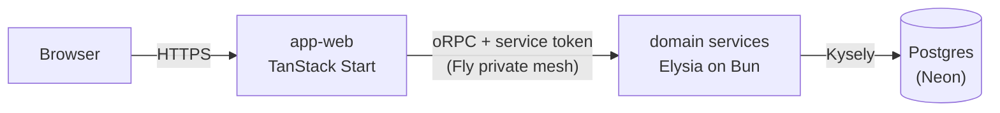

# Overview

Vers is a browser idle game on a microservice backend. A deterministic simulation runs on the
client, the server verifies its results by replay, and each release
[deploys](./platform/deployment.md) every app from a single SHA. The replay provider apps of older
engine builds are the one exception, described under [Topology](#topology).

## Request path

The web app (`apps/web`) is the only public-facing deployment. Its TanStack Start server renders the
UI and is the trust edge. It holds the session cookie and validates the session, mints a short-lived
signed service token carrying the acting user's ID, and calls domain services through typed oRPC
contract clients over Fly's private mesh. Services verify that token on every call, do their work
against Postgres on Neon, and return typed results.

The oRPC link is isomorphic, and either way the client is typed by the service's contract package
alone ([service contracts](./services/service-contracts.md)).

A user has at most one verified session at a time, so completing a sign-in evicts every other
session on the account, and an evicted device is signed out on its next request
([auth](./services/auth.md)).

## Topology

Each domain service is its own Fly deployment, reachable only on the private mesh. An idle service
scales to zero. Two exceptions: the session and activity services each keep one machine warm
([deployment](./platform/deployment.md#topology)). The replay service runs off the request path: it
carries no player traffic, and the activity service wakes it with a service call each time an append
leaves unverified work. Older engine builds stay replayable through per-version replay provider
apps. The deploy CLI provisions one for each new engine build, and it keeps running the image of the
release that created it, so these apps are the one part of the fleet that a later release leaves on
an older SHA ([sim-version registry](./game/replay-verification.md#sim-version-registry)).

Each server image is built from its app's Dockerfile
([container builds](./platform/container-builds.md)). The external accounts and settings around the
fleet, such as Neon, Axiom and the GitHub repo, live in the `infra/` Pulumi program, which applies
on merge ([infra deploys](./platform/infra-deploys.md)).

## Data

The shared Neon database holds three shapes of game data, and it scales to zero when nobody is
playing ([database](./platform/database.md)). Every application table is accessed through Kysely and
migrated by kysely-ctl in `@vers/db`. One exception: pg-boss owns the `pgboss` schema and migrates
it itself ([queues](./platform/queues.md)).

- **Relational identity data** — users, sessions, verifications, and avatars.
- **The activity checkpoint tables** — an append-only checkpoint log plus a per-activity head row
  that carries the simulation's progress and the cursors its verification advances
  ([checkpoint streams](./game/game-simulation.md#checkpoint-streams)).
- **Seed chain state** — one row per `(avatar, chain scope)` pair, which hands each activity at a
  scope the seed it draws from ([the seed chain](./game/seed-chain.md)).

## Game layer

The simulation is deterministic. A seeded tick engine (`@vers/idle-core`) runs combat in a
SharedWorker on the client and emits a stream of hash-chained checkpoints
([game simulation](./game/game-simulation.md)). Encounter derivation is a pure function of node seed
and difficulty that lives in shared libraries rather than a service, so the client and the verifier
compute identical encounters from the same inputs.

The server trusts progress only through replay. The client submits checkpoint batches to the
activity service, and the verifier replays the same seeds server-side and compares results before
progress settles ([replay verification](./game/replay-verification.md)). The checkpoint hashes chain
the stream together but do not attest combat outcomes. Replay is the proof, for offline progress
too: the device simulates the time it spent out of contact, delivers that progress on reconnect, and
the verifier replays it and settles it in play order
([offline reconcile](./game/offline-reconcile.md)).

Every random outcome comes from a named entropy source, whose security properties decide whether a
reward may carry tradeable value ([game entropy](./game/game-entropy.md)). One interpreter turns a
roll from any source into item content ([item generation](./game/item-generation.md)). The
[glossary](./game/glossary.md) defines the terms the game docs share.

The world map (`@vers/worldmap-*`) gives every avatar a distinct, unbounded graph generated on
demand: the client derives its geometry locally from a deterministic hex lattice while the server
seals each node's content behind a per-avatar secret, so map shape reveals nothing about reward
([world map](./game/worldmap.md)). The client renders that graph with three.js through
react-three-fiber ([game rendering](./game/game-rendering.md)).

## Cross-cutting

- **Service-to-service (s2s) auth** — services trust no caller, the private mesh included; every
  call carries a short-lived signed token from a registered issuer
  ([s2s tokens](./services/auth.md#service-to-service-tokens)).
- **Contracts** — each service declares its API in its own `@vers/contract-*` package, oRPC
  contract-first with Zod schemas owned by the declaring contract
  ([service contracts](./services/service-contracts.md)).
- **Single-SHA release** — contracts are unversioned workspace source packages, and each release
  deploys every app from one SHA, apart from the older replay provider apps
  ([deployment](./platform/deployment.md)).
  [Service contracts](./services/service-contracts.md#change-discipline) owns the change discipline
  that keeps consumers and services in step.
- **Observability** — OpenTelemetry sends traces, logs, and metrics to Axiom; the Sentry SDK sends
  errors to Bugsink. The service runtime wires both into every service, and one trace id follows a
  request from edge to service ([observability](./platform/observability.md)).
- **Error handling** — one taxonomy classifies every failure, sets its status and decides whether it
  reaches Bugsink, in the services, the web app and the idle worker
  ([error handling](./services/error-handling.md)).
- **Analytics** — Umami counts site visits and the acquisition funnel, and Tinybird holds the
  product events of what players do in the game ([analytics](./analytics.md)).
- **Feature flags** — every flag check goes through OpenFeature, served by an in-house provider
  ([feature flags](./services/feature-flags.md)).
- **Rate limits** — the web app's server answers a request over its tier's budget with a 429 before
  any handler runs ([rate limits](./services/rate-limits.md)).
- **Providers** — each concern runs on one provider behind a vendor-neutral interface
  ([service providers](./services/service-providers.md)).
- **Manual QA** — a QA pass drives production at `https://versidle.com` with an account under
  `qa.versidle.com`, a debug Chrome, and the `bun run qa:*` scripts that seed accounts, read
  verification email, log worker traffic, and send the fleet cold ([manual QA](../runbooks/qa.md)).
- **Load runs** — a local compose stack of the pipeline's production images takes typed player
  clients through steady play, synchronized offline returns, and a dependency outage, and reports
  settlement age and resource use per scenario ([load runs](../runbooks/load.md)).

## Projects

AGENTS.md's monorepo layout owns the workspace globs and the naming rule that derive the project
list. Members whose behavior differs from their set: `libs/game/worldmap-content`,
`libs/testing/qa-account` and `libs/testing/load-harness` are `server-only`, the second because it
imports the first and the third because it signs service tokens and writes the database directly;
`libs/design/styled-system` is generated output; and `libs/game/content-version` is shared by the
deploy CLI, the sim-version registry and the content digest check, so a content version bump and its
recorded digest land in one package.
