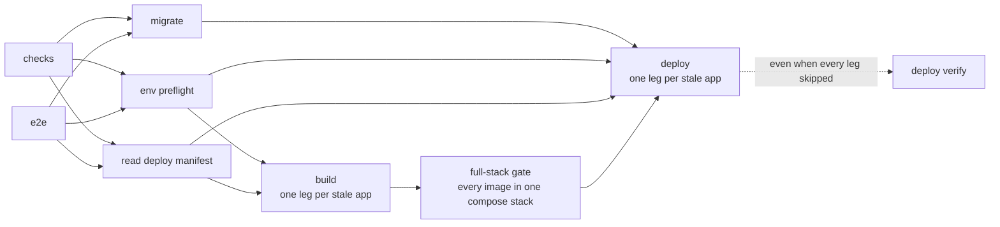

# Deployment

The stack is a Fly.io fleet, and a push to `main` drives every rollout through the repo's deploy CLI
and its manifest, `deploy.config.ts`. Every rollout decision keys off one marker: the commit stamped
into each app's machine env, compared against HEAD ([staleness](#staleness)).
[Provisioning](../../runbooks/provisioning.md) stands the fleet up from nothing.

## Topology

The web app, the error tracker, and the analytics dashboard hold public addresses. Every domain
service (every `services/*` app) is private, reachable only across the organization's private mesh.
Browsers post error envelopes to the tracker directly, and analytics tracker traffic arrives through
the web app's same-origin proxy ([analytics](../analytics.md)). All persistent state is the shared
Neon database ([database](./database.md)): no app runs its own Postgres, and the keys service holds
no database connection at all, only its root secrets.

An idle app scales to zero. Fly suspends an idle machine with its memory snapshot and wakes it on
its first request, so a suspended process resumes with the sockets it held
([connection pool](./database.md#connection-pool)). Three deviations:

- The web app, the session service, and the activity service each keep one machine warm, because
  every request passes through the first two and a session's first tap reaches the third.
  `deploy verify` enforces the minimum through the manifest.
- The email service stops rather than suspends, the queue-hosting policy ([queues](./queues.md)).
- The replay service carries no inbound player traffic; a drain holds its machine up until its queue
  is empty ([replay](../game/replay-verification.md#replay)).

## Networking

The web app reaches a service at a private address that load-balances across the service's machines
and wakes a suspended one on demand. A service is allocated no public IP, so nothing outside the
mesh can reach it, and mesh traffic is already encrypted, so a service enforces no HTTPS of its own.
The web app's outbound dispatcher caps a pooled connection's idle keep-alive below Fly's suspend
window, because a keep-alive socket to a suspended machine looks usable while a request written onto
it neither arrives nor wakes the machine.

Each manifest entry declares its exposure, public or private. The deploy CLI allocates a missing
private address before the entry's rollout cuts over, and `deploy verify` fails a private entry that
holds a public address or lacks its private one.

## Secrets

Non-sensitive config (service URLs, the environment name, the log level) lives in each `fly.toml` or
Dockerfile. Secrets are set with `fly secrets set` and never committed, and each app's env contract
declares the keys it needs ([env preflight](#env-preflight)). Service-to-service auth runs on one
keypair per minting service: each minter holds its private half in its own app's secrets, and every
domain service verifies inbound calls with the key set holding each minter's public half
([auth](../services/auth.md#service-to-service-tokens)). The meaning of every other secret belongs
to the doc of the feature that reads it.

The browser-side values ride GitHub Actions configuration. The deploy workflow bakes the browser
error-tracker DSN and the analytics website id into the web app's client bundle as build args, and a
bundle without the website id ships no analytics tracker ([analytics](../analytics.md)). Source-map
uploads authenticate with an Actions secret, and the build skips source maps when it is unset.

### Shared secrets

A shared secret holds one value on every app that carries it. Each manifest entry that carries one
lists it, and you set a shared secret once, with the same value, on every declaring app.
`deploy verify` reads each declaring app's secret digests and fails the run when a shared secret
holds more than one digest across those apps, or when a declaring app does not hold it at all,
naming each app under its digest prefix. The database connection string is the shared secret every
domain service that opens a connection carries.

## Release

A push to `main` runs the main workflow. The `checks` and `e2e` jobs run side by side, and every
later job waits for both to pass. Each build and deploy leg self-gates on staleness, so a phase lost
to an earlier failure ships on the next push.

### Pipeline

Neon migrations apply once, in their own never-cancelled `migrate` job, because several services
share one database. Before the job applies a pending migration, it creates a Neon branch off `main`
as the backup point and logs the branch's name. A backup that fails stops the job before any
migration runs, and a [database restore](../../runbooks/database-restore.md) starts from that
branch. Database migrations are never rolled back: a release must tolerate every migration applied
after it shipped (expand and contract), which is what makes redeploying a previous image safe.

The build and deploy matrices derive from the manifest, so adding an app to the manifest is the
whole change. An app's failed build leaves its ref unavailable to the full-stack gate, whose
fleet-wide failure holds every cutover.

### Staleness

The CLI relates the commit stamped on the app's machines to HEAD before it reads any diff. A
deployed commit that is HEAD or descends from it is current, which happens when a later push's
deploy lands while this run is still between its legs: `deploy verify` passes the app, and a deploy
leg skips it rather than roll it back. `deploy verify` also passes a fleet split between HEAD's
image and a descendant's, as long as every started machine on HEAD's image passes its health checks,
and a machine on any other image fails the run. A deploy leg reads a split fleet as stale, because
no single commit is stamped across its machines, and redeploys HEAD.

For an older deployed commit, the change set is the paths git reports changed since it plus the
packages turbo reports affected from that base. The app's manifest trigger reads that set: a
turbo-affected trigger is stale when its package is affected, and a paths trigger is stale when a
changed path matches one of its globs. A path the root `.dockerignore` excludes never counts as a
change, because a file the build context never holds cannot change an image. The filter never
reaches turbo's affected set, so a README edit under an app's directory still ships that app.

### Env preflight

Each service commits its env contract, the sorted required and optional key lists derived from its
env shape merged over the base schema; a key is required exactly when its schema rejects an absent
value. `bun run env:contract` regenerates the artifacts, so a PR that adds a required key shows it
in the diff. The checks job fails on a stale artifact and on a required key missing from the
service's dev env files or either compose stack. Keys a Dockerfile bakes into the binary from build
args count as covered wherever the built image runs.

The `preflight` job gates `build` and `deploy`: every required key of each contract-carrying app
must appear in its `fly.toml` env table, its set Fly secrets, or its baked build args. Fly reports
secret names and digests only, so no secret value enters the run.

### Full-stack gate

Between build and cutover, the `stack-e2e` job boots every deployable image in a compose stack:
every service image, the web app's production image, postgres, and a capture-only email stub. It
migrates the stack's own database and drives the e2e suite's stack journeys against it. The gate is
fleet-wide by design: a combined state that fails its journeys ships for no app.

### Build and cutover

A stale build leg builds on Fly's remote builder and pushes the image under a tag derived from the
commit, so no image blob crosses from the GitHub runner and no ref travels between jobs. Re-running
a leg overwrites its own tag. flyctl sets no deadline on a remote build, whose push can stall with
no output. The deploy CLI rebuilds after a silence no healthy build shows, and the Build step's
timeout fails the leg before the job's. A stale cutover leg deploys that pushed ref, waits for the
fleet to report the new commit, then runs the app's post-deploy probes from the manifest: an HTTP
status check, a JSON round-trip against an expected body, or a Lighthouse audit of the live page
against the manifest's performance budget. An app with no Dockerfile cuts over to the image named in
its `fly.toml`. For a manual rollout, the CLI's `deploy` command runs both phases in one invocation.

An app whose `fly.toml` sets the blue-green strategy, which is every app the repo builds, rolls out
that way: Fly boots a parallel fleet, gates it on `/health`, cuts traffic over, then retires the old
machines. A broken boot fails the gate before cutover, and the old machines serve every request
until it passes. The deploy CLI bounds flyctl's wait for each machine, so a green machine that never
turns healthy fails the rollout and flyctl destroys the green machines itself. A flyctl call still
running at a later deadline gets SIGINT, its ctrl-c, which aborts a rollout that is still waiting
and destroys its green machines. A grace after that, it gets SIGKILL. Both bounds end before the
deploy job's timeout, which would otherwise kill flyctl mid-rollout and leave the green machines
started. The two pinned upstream apps set no strategy and roll over in place. Deploy jobs queue
rather than cancel. When a newer run starts its build, full-stack gate or fleet verification while
an older run's same job is still running, the older job is cancelled, because the newer run ships
the same apps. The rest of the older run then skips: the full-stack gate after a cancelled build,
fleet verification after a cancelled build or full-stack gate, and the failure alert after any
cancelled job. A rollout can fail on a transient host-capacity refusal; Fly rolls back cleanly, so
re-run the failed job.

### Release record and rollback

A rollout whose probes pass is recorded in the release registry: app, commit, image ref, and the
digest the fleet resolved it to. The release record runs under its own deadline, and the deploy CLI
exits as soon as its command ends, so neither a stalled write nor a browser the probes left running
holds the deploy job until its timeout. The newest row per app is that app's rollback target. A
rollout whose probes fail rolls back: the CLI redeploys the app's newest recorded release,
restamping that release's own commit so the fleet reads stale against HEAD and the next push ships
the fix. The leg still fails, because rollback restores service and never greens the run. An app
with no recorded release yet is left serving the broken release, reported in the leg's log.

### Fleet verification

`verify-fleet` runs on every green push that no newer run replaced, even when every deploy leg
skipped, and asserts every manifest app is online and current, catching an app at zero machines or a
fleet behind HEAD. A rolled-back app reads stale there by design. It also checks each private
entry's addresses ([networking](#networking)), each declared scheduled machine against the app's
image, and each shared secret's digests across its declaring apps.

### Scheduled machines

A scheduled machine is unmanaged: `fly deploy` never rolls its image forward. An app entry declares
each one in the manifest, and the CLI reconciles the declarations right after the app's rollout
lands, and on its skipped-deploy path alike: it creates a declared machine that does not exist yet
on the app's just-deployed image and moves one on a stale image onto it. When the machine's host has
no room for the new image, the CLI replaces the machine: it creates a new one on the new image, then
destroys the old one. Fly names are unique per app, so the replacement takes the declared name with
a short commit suffix, and every scheduled machine the CLI creates carries the declared name in its
`vers_scheduled_machine` metadata, which the reconcile and `deploy verify` read before the Fly name.
Provisioning a new scheduled machine is a manifest edit. A declaration carries its own env map,
because a scheduled machine reads no `fly.toml` env table.

### Stranded-machine sweep

A deploy or cutover leg reads the fleet before running flyctl and groups its machines by image.
Multiple groups mean a prior rollout left machines stranded on a second image, and the leg sweeps
them. It keeps the group whose machines all carry the app's recorded release commit, or else the
single image group holding a started machine whose health checks all pass, destroys every machine
outside it, then proceeds. A started machine outside the kept group is never a destroy target; the
leg fails instead and prints the fleet's machine table for an operator. `deploy verify` never
sweeps; it reports a mixed-image fleet as its own finding.

### Pinned upstream images

The error tracker and the analytics dashboard ship pinned upstream images. Neither sits in the turbo
task graph, so their staleness triggers are path globs, and upgrading either is a tag bump. The
tracker's tag is in its Dockerfile, which adds object storage for uploaded files over the stock
image. The dashboard's is in its `fly.toml`.

## Infra drift

A scheduled workflow runs a Pulumi preview over the `infra/` program's production stack and fails on
any diff. The workflow also runs on pull requests and pushes touching `infra/`, but console drift
arrives with no commit, so only the schedule catches it. The job authenticates through a 1Password
service account scoped to read the `vers-ci` vault. One `op run` resolves every reference in the
program's example env file, so a run signs in to 1Password once, not once per secret. It only ever
previews; reconciling a reported drift is a human decision, applied with `pulumi up` from a
checkout.

## Container builds

Fly's remote builder builds every server image from the app's Dockerfile. Every domain service
builds from the one service Dockerfile, and the service's folder name reaches it as the `SERVICE`
build arg from the app's `fly.toml` and from its compose service. Each Dockerfile opens with a prune
stage that cuts the workspace to the target's dependency graph with `turbo prune`, and its later
stages install, build, and assemble a minimal runtime. The install stages run a frozen install from
the pruned manifests and the pruned lockfile, so the build fails when bun resolves the smaller
workspace differently from the lockfile that turbo wrote. That round trip depends on the turbo
release, because older releases kept the root workspace's hoisting choices in the pruned lockfile
(turborepo#11007). The prune stage therefore runs the turbo version from the workspace catalog. The
deploy pipeline builds the images only after a merge, so a pull request that changes a Dockerfile, a
package manifest, the lockfile, or a patch builds every server image in the PR checks.

Every domain service compiles to a Bun executable and runs it on `alpine` as `nobody`, with no
`node_modules` and no source. The build compiles each entrypoint a service has into its own binary,
so two images carry more than the server binary:

- The email service's image carries the sweep binary its scheduled machine runs
  ([queues](./queues.md)).
- The replay service's image carries the drain binary its scheduled machine runs, and the provider
  binary that each per-version replay provider app runs
  ([sim-version registry](../game/replay-verification.md#sim-version-registry)).

The web app bundles an SSR server instead of a Bun executable: a full install with dev dependencies
for the build, then a production-only install with the hoisted linker, so the SSR bundle resolves
every runtime import from one flat `node_modules`. Its server entry carries no top-level `await`,
because a dynamically imported chunk can import the entry back and Node exits on the unsettled
cycle.
