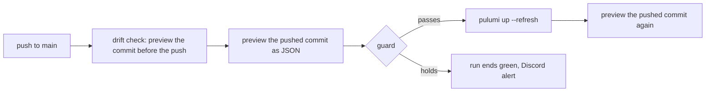

# Infra deploys

Two GitHub Actions workflows run Pulumi on the production stack of the `infra/` program, with the
secrets in the `vers-ci` 1Password vault. Drift is a difference between the live resources and the
program on `main`, such as a setting that a person changed in a provider's console. Both workflows
watch the same files: `infra/`, their own scripts, and the root `package.json` and `bun.lock`, which
pin the program's Pulumi packages. A person answers drift and every plan that the guard holds, as
the [infra runbook](../../runbooks/infra.md#answer-a-held-apply) describes.

## The apply on merge

The `deploy` job of `infra-deploy` runs on each push to `main` that changes a watched file. Its
drift check previews the commit before the push with `--expect-no-changes`. A change there is drift,
or an earlier push whose plan the guard held. The job then previews the pushed commit as JSON, and
the guard holds that plan when:

- a step does anything but create, update, read or refresh a resource;
- the drift check found a change.

When the guard passes the plan, the job runs `pulumi up --refresh`. A last preview with
`--expect-no-changes` fails the job when the stack still differs from the commit.

A held plan stays unapplied, and its run ends green with a Discord alert. A person applies it by
dispatching the workflow on `main`. The dispatched run skips the drift check and applies the plan of
main's tip whatever the guard finds, so it also applies each push that landed after the held one. A
dispatched run whose commit is no longer main's tip when the guard reads the plan holds, such as a
rerun of an old dispatch, because its plan would revert each change applied since. A later push
holds too while the commit before it differs from the live stack, such as while the held change
stays unapplied. A push that reverts the held change holds as well, and the push after the revert
can pass, because the revert's commit matches the live stack.

## The preview on a pull request

The `preview` job of `infra-drift` runs on each pull request that changes a watched file. It
previews `main` with `--expect-no-changes`, which fails the job on drift. It then previews the pull
request's own change, which fails the job only on an error. The job summary shows both previews. The
`preview` job is an advisory check: the ruleset in `infra/github.ts` leaves it out of the required
checks.

The same job runs weekly on `main` with `--expect-no-changes`, because drift from a console arrives
with no commit.

## One job at a time

The `deploy` job and the `preview` job share the `infra-prod` concurrency group, so they run one at
a time, and the group keeps every waiting run. A preview takes no lock on the stack's state, so a
preview beside an apply would read a half-applied stack. The `deploy` job never cancels, because a
cut-off apply leaves the stack half changed and leaves Pulumi's lock in the state.
